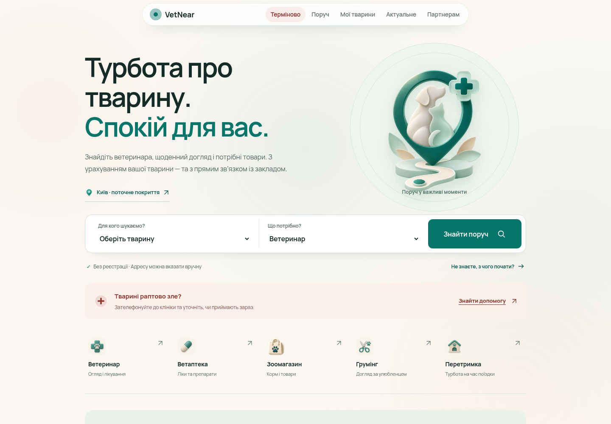
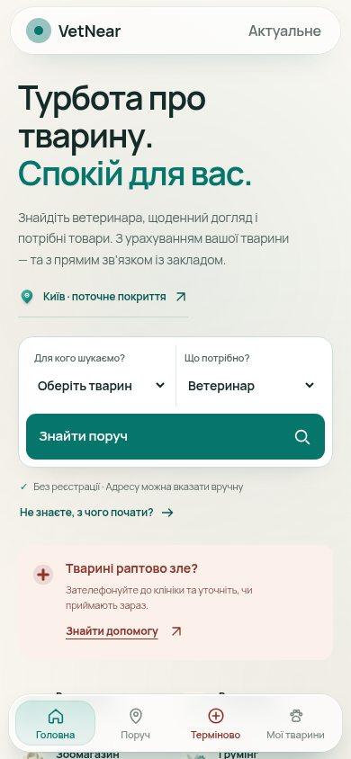
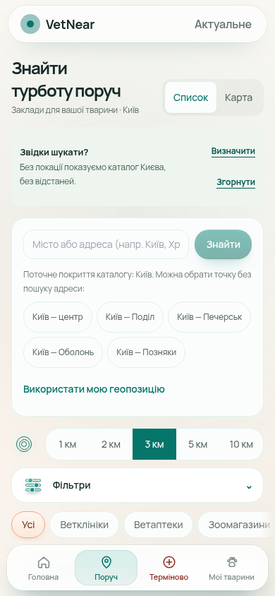
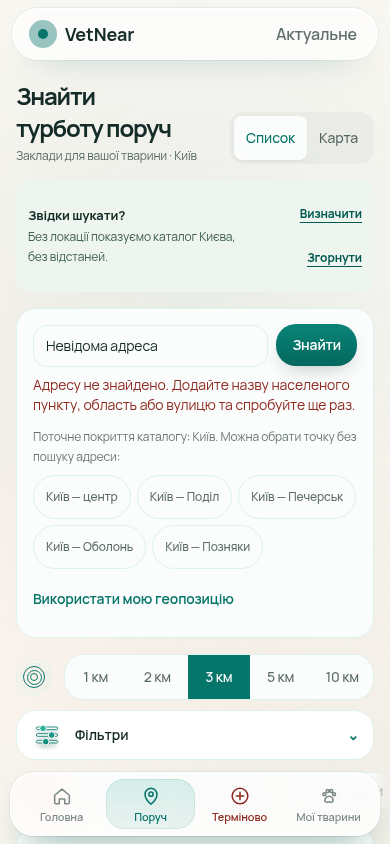
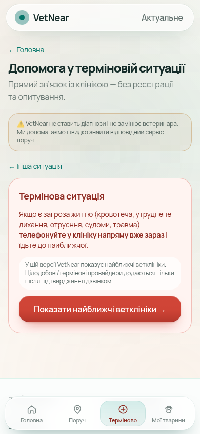
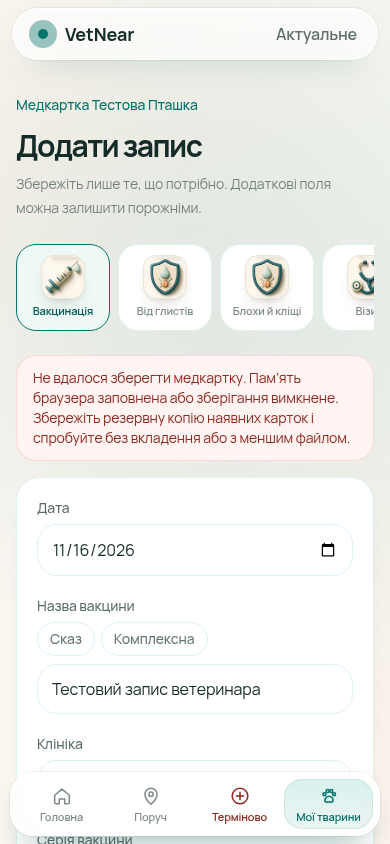

# VetNear 1.31 — разбор пользовательского пути

16 ноября 2026. Проверен локальный production build в Chromium. Основной путь: главная → животное и услуга → локация → результаты → контакт; отдельно — срочная помощь и сохранение медицинской записи. Живые обращения в клиники, публикация и изменения внешних данных не выполнялись.

## Что изменилось на экранах

| Шаг | Сценарий и состояние | Наблюдение и результат |
|---|---|---|
| 1 | Главная, улучшено и проверено | В версии 1.30 на мобильном первый экран занимали иллюстрация, текст и счётчики, а услуги начинались ниже. Демонстрационная клиника справа на desktop выглядела как реальный результат. В 1.31 форма выбора животного/услуги находится на первом экране; вымышленная клиника и обещание 90 секунд удалены. Основная кнопка видима при 320/390/768/1440 CSS px; горизонтального переполнения главной не обнаружено. |
| 2 | Поиск и фильтры, улучшено и проверено | Вид животного и услуга передаются с главной в выдачу. Появился поиск по названию/адресу и порционная выдача. Смена активной медкарты синхронизирует вид; несовпадающая сохранённая карта не подставляется в запрос. Radio-контрол радиуса поддерживает клавиатуру. |
| 3 | Ручная локация и ошибка адреса, исправлено и проверено | Пустой ответ геокодера сохраняет запрос и показывает ошибку. Не выбирает Киев вместо адреса. Именованный результат требует нажатия. GPS вызывается явно; отказ открывает ручную форму, которую можно свернуть. Возврат на страницу сохраняет свежую ручную точку без нового GPS-запроса. |
| 4 | Результаты и карта, проверено с ограничениями | Без координат экран честно показывает каталог без расстояний. Поиск несуществующего имени даёт отдельное пустое состояние с восстановлением. Переключение карты проверено до появления Leaflet; качество внешнего маршрута, дорожная обстановка и полнота внешних карт не оценивались. Время и статусы дополнительно проверены unit-тестами, а не выводятся только из скриншотов. |
| 5 | Срочная помощь, исправлено и проверено | Кнопка «Терміново» открывает срочный блок сразу. Переход к обычным клиникам сохраняет urgent context и отключает платное продвижение; при этом не выдаёт обычную клинику за phone-confirmed emergency. Ранжирование и evidence gate покрыты регрессионными тестами. |
| 6 | Медкарта и новая запись, исправлено и проверено | Создана фиктивная карточка птицы. Следующая медицинская дата по умолчанию пуста. При имитации исчерпанного хранилища появляется ошибка, введённое название записи остаётся, переход с формы не происходит. Валидация backup и вложений проверена отдельными DOM/unit тестами. |

## Принятые скриншоты

### 1. Главная на компьютере

### 1. Главная на узком экране

### 2 и 4. Выдача

### 3. Адрес не найден

### 5. Срочная помощь

### 6. Ошибка сохранения

## Проверки доступности и границы вывода

Проверены подписи полей главного поиска, видимый основной CTA, отсутствие горизонтального переполнения главной на четырёх ширинах, семантика выбора карта/список, клавиатура радиуса, согласованность раскрытия формы и сохранение введённых данных при ошибке. Снимки сделаны с `prefers-reduced-motion: reduce` для стабильной оценки. Читаемость и группировка просмотрены визуально.

Это не полный аудит WCAG 2.2 AA. Нужны отдельные проходы с VoiceOver/TalkBack/NVDA, системным увеличением шрифта, масштабом 200%, количественным замером контраста по всем страницам, реальными iOS/Android устройствами, ограниченной сетью и длительно открытой вкладкой. Открытость/ранжирование по расписанию пока не обновляются по таймеру в долгоживущей вкладке; этот сценарий включён в следующий этап.

## Что не закрывается внешним видом

1. География, районы, тревоги и ограничения публикации остаются привязаны к Киеву; локация в другом городе не означает наличие каталога там.
2. `exotic`/`other` не заменяют полноценную таксономию и подтверждённые компетенции: кролики, рыбы, амфибии, лошади и сельхозживотные требуют отдельных сценариев.
3. Медкарты локальные: очистка браузера может удалить сведения; резервное копирование необходимо. Синхронизация, совместный доступ и редактирование отдельных записей — отдельный этап.
4. Публикация и приостановка требуют транзакционности/восстановления, исключения снятых seed-записей и пагинации. Клиент теперь показывает ошибку публикации, но это не заменяет серверную гарантию.
5. Production Supabase, токены тревог, доступность укрытий, фактический приём врачей и пользовательские метрики требуют проверки в реальной конфигурации.

## Итог автоматизированных проверок

`npm run verify`: ESLint + TypeScript + 387 тестов в 32 файлах + production build успешно. `npm audit --omit=dev`: 0 известных уязвимостей на момент проверки. Девять изолированных браузерных сценариев прошли; список в `qa/browser-qa-results.json`. Геокодирование и сбои хранилища в негативных сценариях имитировались; пользовательские записи были фиктивными.
