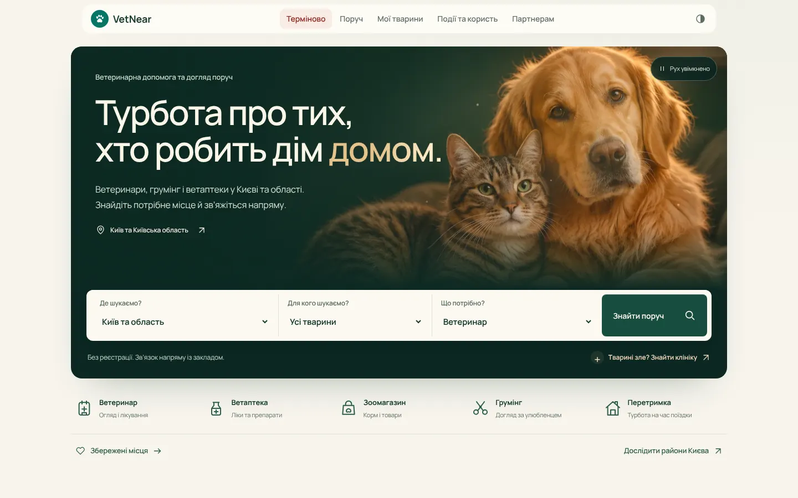
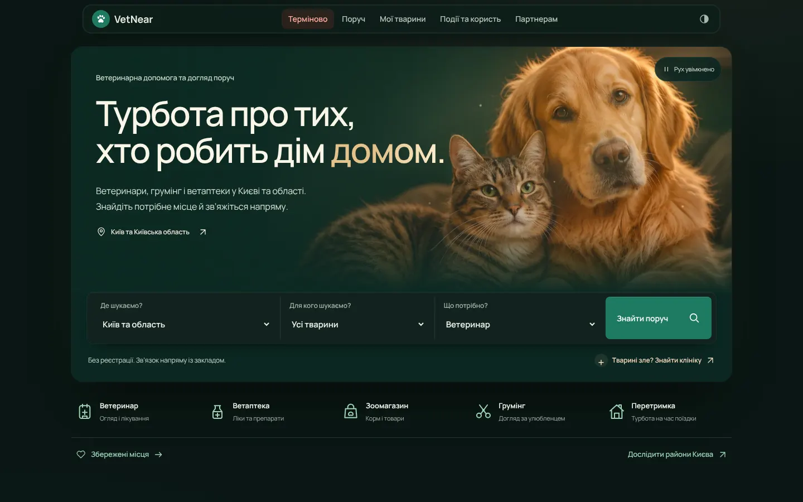
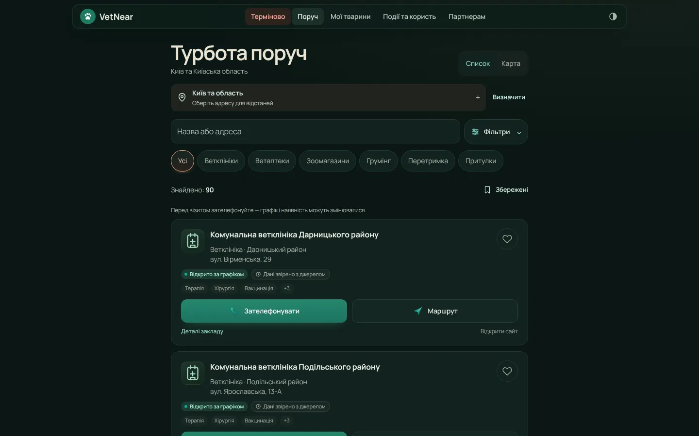
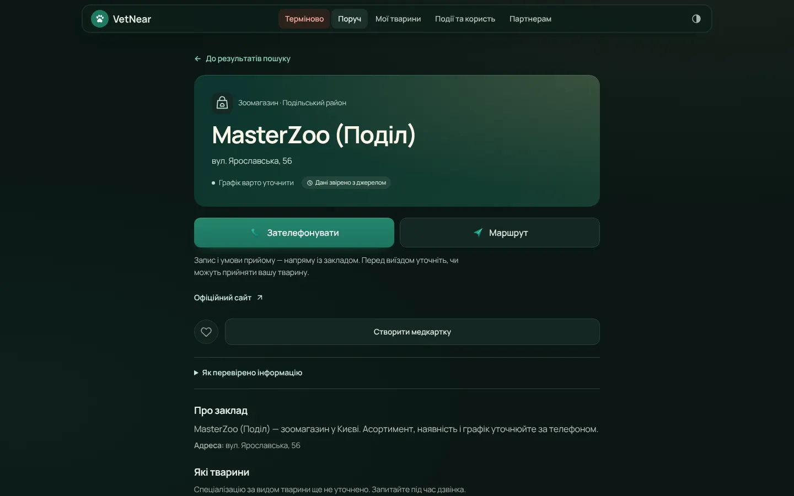
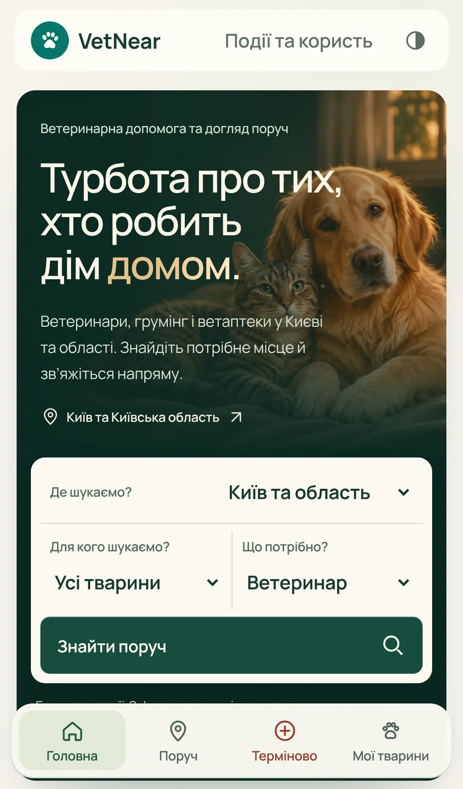
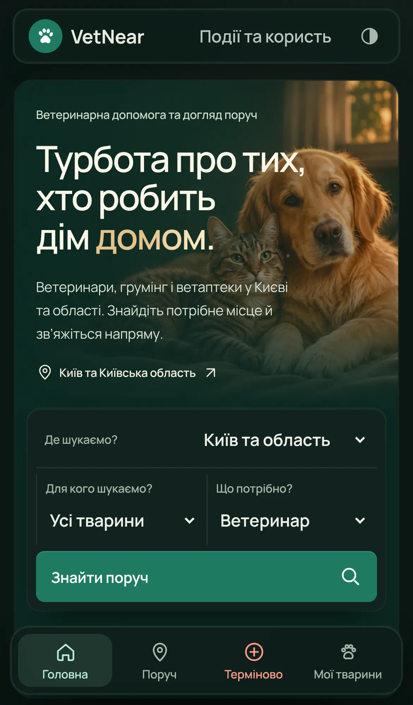

# QA 1.35 — тема, контраст, кінематографічний герой

Перевірено локальну production-збірку (`next build && next start`) у Chromium через Playwright.

## Автоматичні перевірки

- `npm run verify` — пройдено: актуальність згенерованої темної теми, ESLint, TypeScript, **579 тестів у 61 файлі**, production-збірка. Лог: [verify-v135.log](verify-v135.log).
- **Браузер: 62/62 перевірки** ([browser-checks.json](browser-checks.json)):
  - охоплення: 6 сторінок × (iPhone 13, 1440×900) × (світла, темна);
  - на кожній сторінці: тема застосована, горизонтального прокручування немає; помилок консолі чи сторінки немає;
  - перемикач:
    - цикл «система → світла → темна», вибір зберігається, aria-label описує наступний крок;
    - **без спалаху:** після перезавантаження із заблокованими JS-бандлами сторінка одразу темна;
    - у режимі «система» тема змінюється слідом за ОС без перезавантаження;
    - друк відбувається у світлій темі, після друку тема відновлюється;
  - рух:
    - за `prefers-reduced-motion` немає жодної запущеної анімації, а кнопка паузи вимкнена;
    - курсор оновлює нахил (`--px`), пауза ставить `data-motion="off"`.

## Контраст (WCAG AA, 12 сторінок)

| | Світла | Темна |
| --- | --- | --- |
| 1.34 | 293 вузли нижче AA | — (темної теми не було) |
| Перший прохід темної теми | — | 242 |
| 1.35 | 11 | 11 |

Залишок однаковий в обох темах: це текст на завжди-темних градієнтних героях (`/`, `/kyiv-updates`, `/for-partners`, `/place/*`). Скрипт бере перший колір градієнта як фон. На скриншотах текст читається; ручна перевірка підтверджує хибні спрацювання.

## Скриншоти

| | |
| --- | --- |
|  |  |
|  |  |
|  |  |

## Не перевірено

Фізичні iOS/Android, Safari/Firefox (для `animation-timeline` діє fallback без прокручувального наїзду), польові Core Web Vitals.
