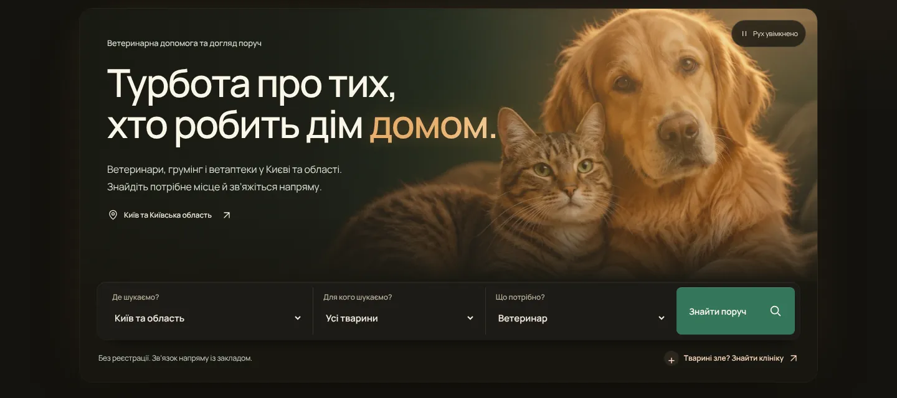
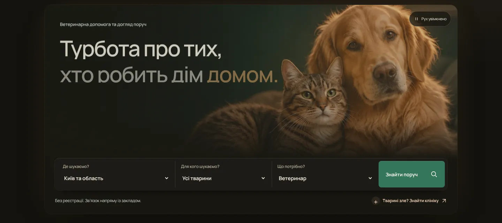
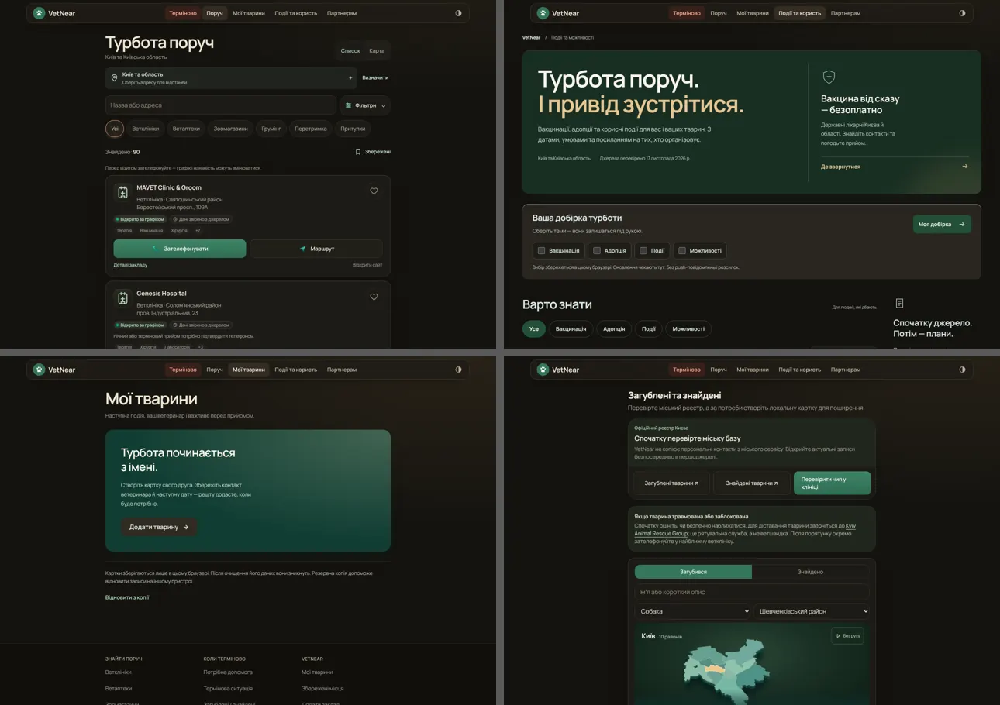
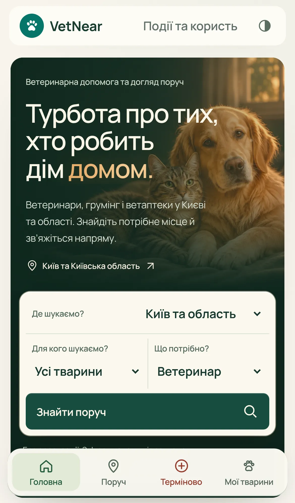
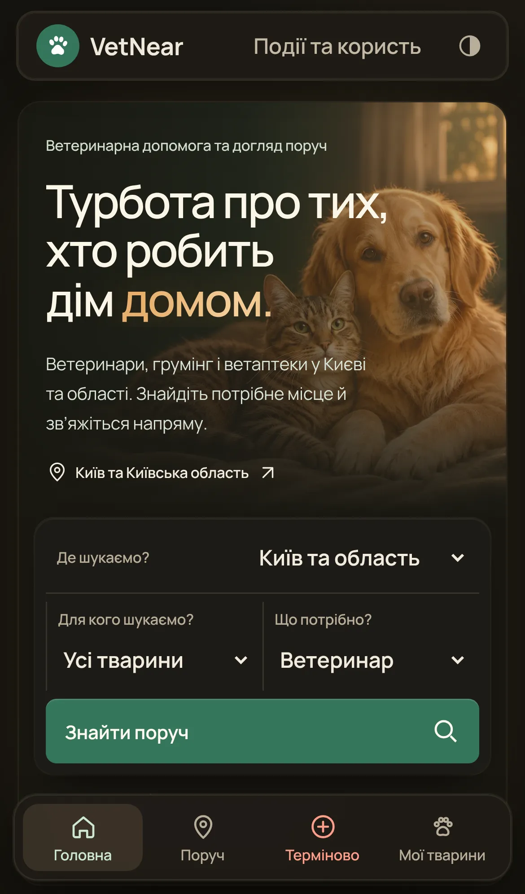

# QA 1.36 — «Лампа у вітальні»

Локальна production-збірка, Chromium (Playwright).

- `npm run verify` — пройдено: актуальність темної теми, ESLint, TypeScript, **580 тестів у 61 файлі**, збірка ([лог](verify-v136.log)).
- Браузер — **62/62** ([browser-checks.json](browser-checks.json)): 6 сторінок × мобільний/десктоп × світла/темна; без горизонтального прокручування й помилок консолі; перемикач теми, відсутність спалаху, друк у світлій темі, `prefers-reduced-motion`, пауза, нахил за мишею.
- Контраст 12 сторінок: темна тема — 7, світла — 11. Залишок — текст на завжди-темних градієнтних героях (хибні спрацювання аудиту, що бере перший колір градієнта).

| | |
| --- | --- |
|  |  |
|  |  |
|  |  |
