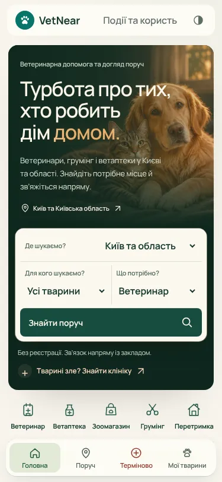
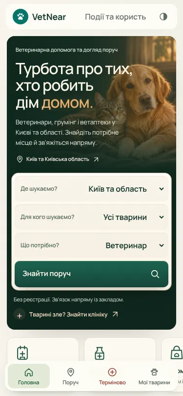
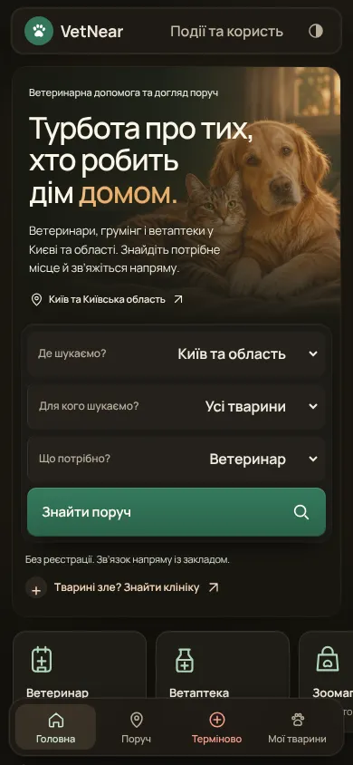
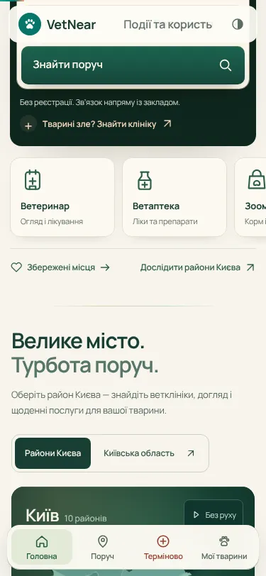
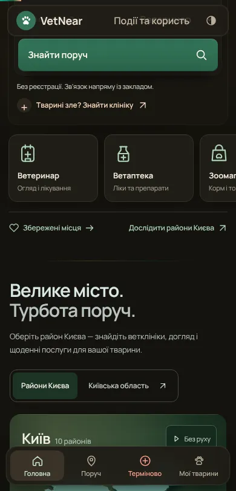
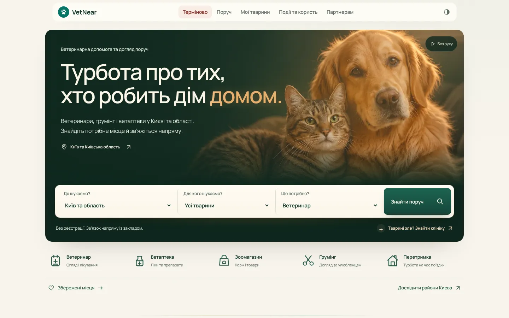
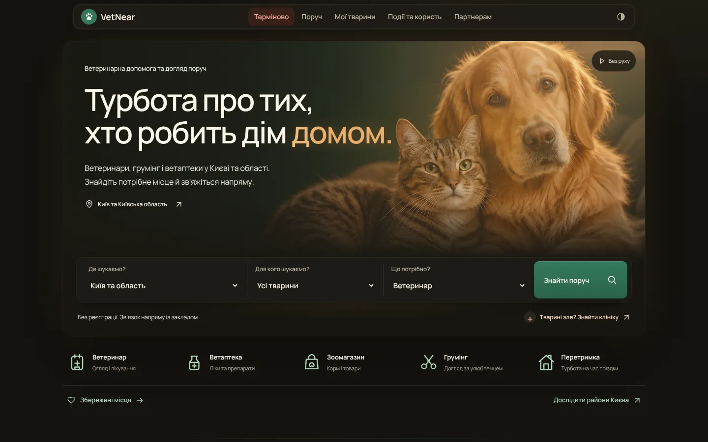
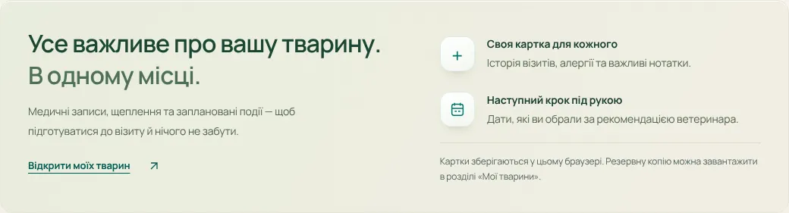

# QA 1.37

- `npm run verify` — пройдено, 581 тест ([лог](verify-v137.log)).
- Браузер — 62/62 ([browser-checks.json](browser-checks.json)). Перевірку друку тепер запускають після гідратації. Раніше вона могла спрацювати до підключення обробника — це було хибне падіння тесту, не дефект.
- Контраст 12 сторінок: 11 / 11 (світла / темна), хибні спрацювання на градієнтних героях.

| До (375, світла) | Після (375, світла) | Після (390, темна) |
| --- | --- | --- |
|  |  |  |

| Стрічка послуг, світла | Стрічка послуг, темна |
| --- | --- |
|  |  |

| Десктоп, світла | Десктоп, темна |
| --- | --- |
|  |  |
|  |  |
