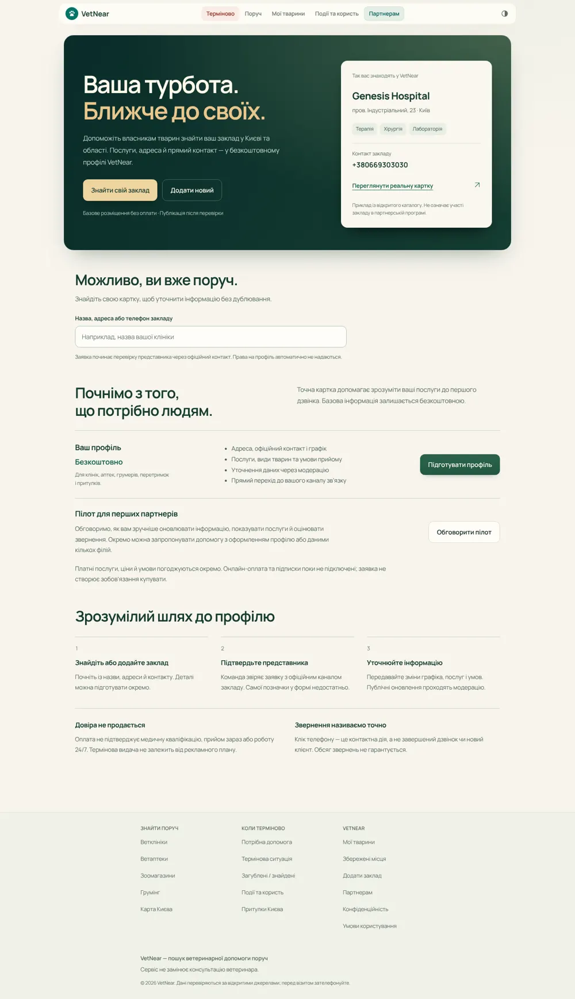
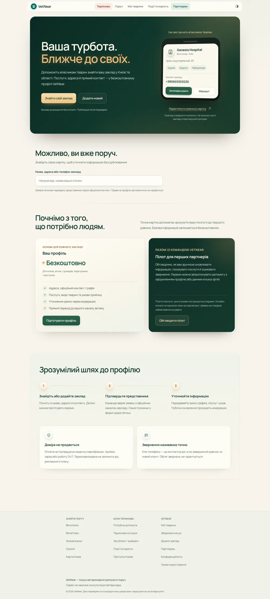
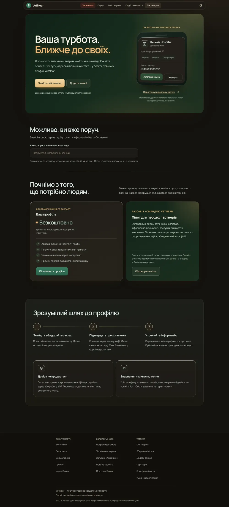
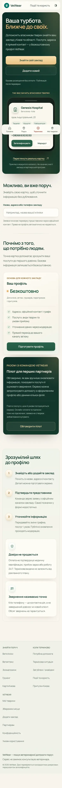
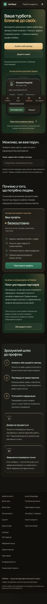
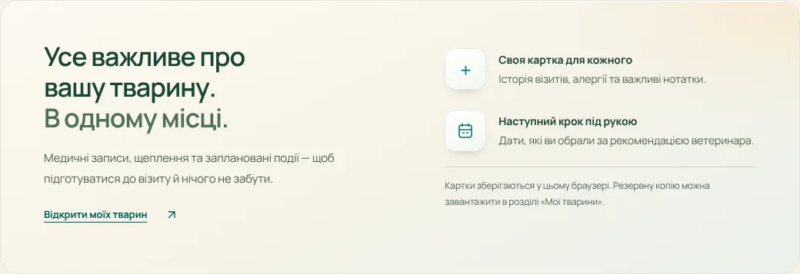
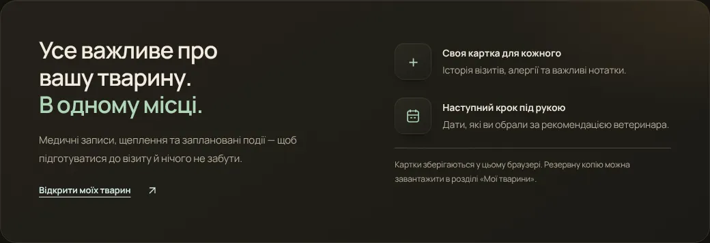

# QA 1.38

- `npm run verify` — пройдено, 581 тест ([лог](verify-v138.log)).
- Браузер — 62/62, двічі ([browser-checks.json](browser-checks.json)).
- Контраст (аудит з урахуванням прозорості градієнтів) — 0 / 0 на 12 сторінках.

| До | Після, світла | Після, темна |
| --- | --- | --- |
|  |  |  |

| Мобільна, світла | Мобільна, темна |
| --- | --- |
|  |  |

| Головна: власник | Головна: партнери |
| --- | --- |
|  |  |
|  |  |
