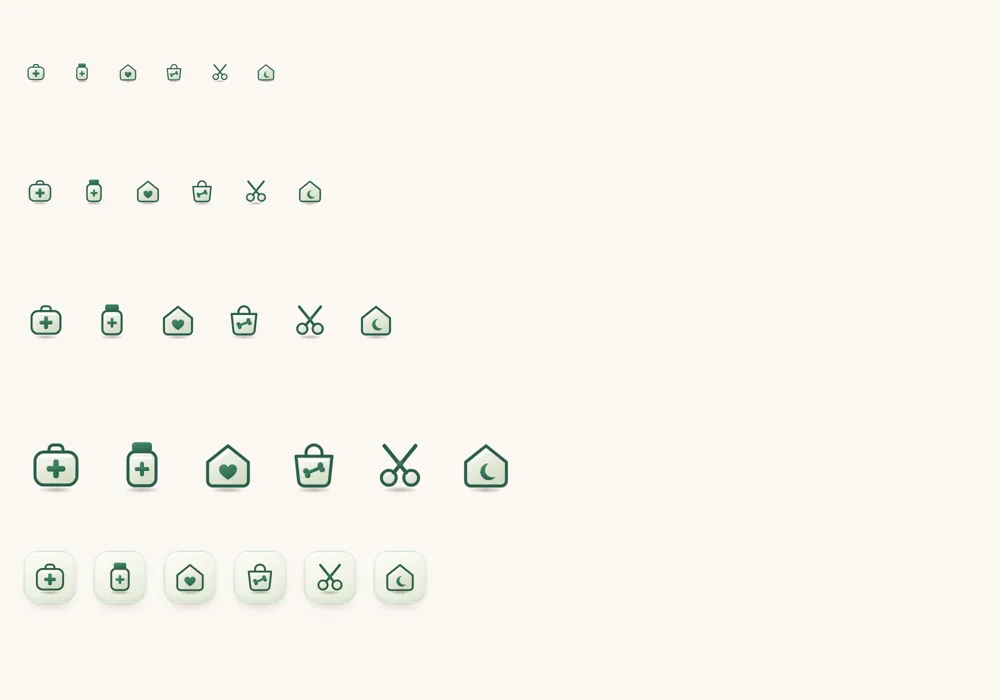
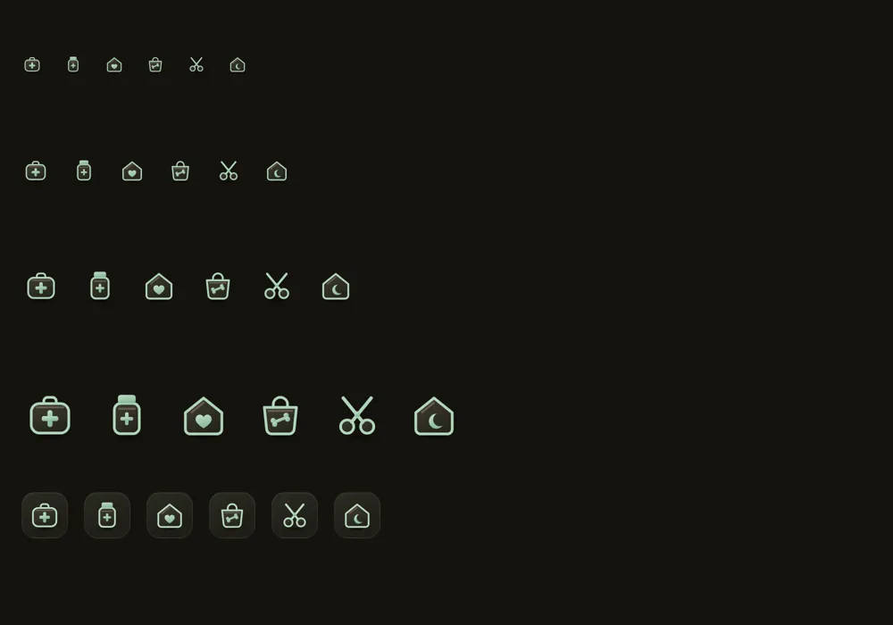
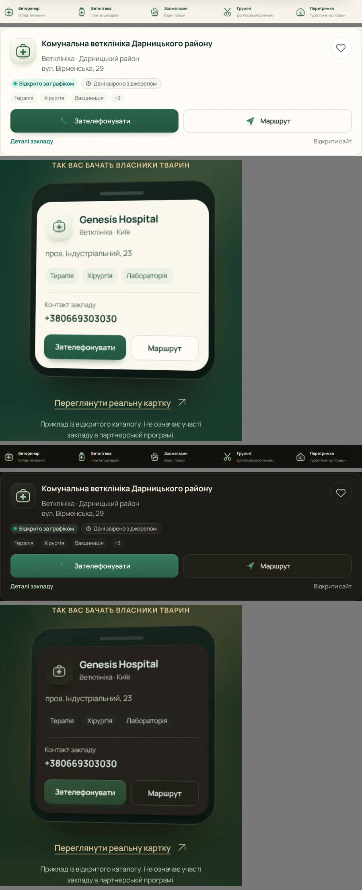
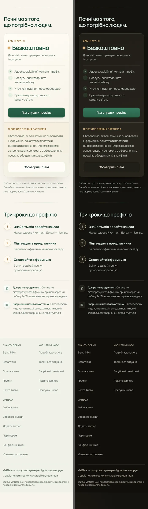
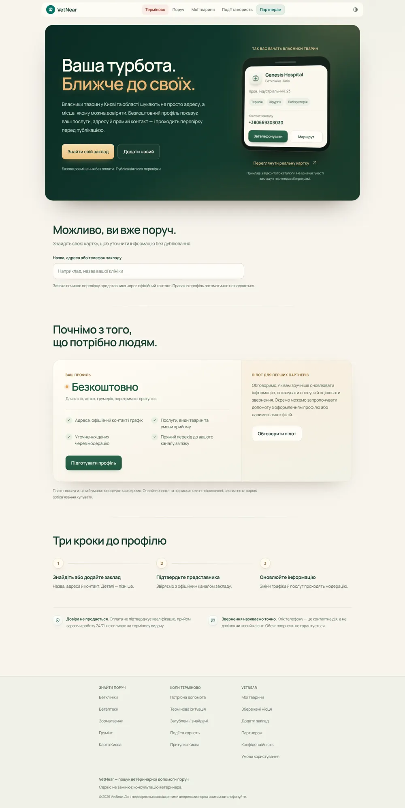
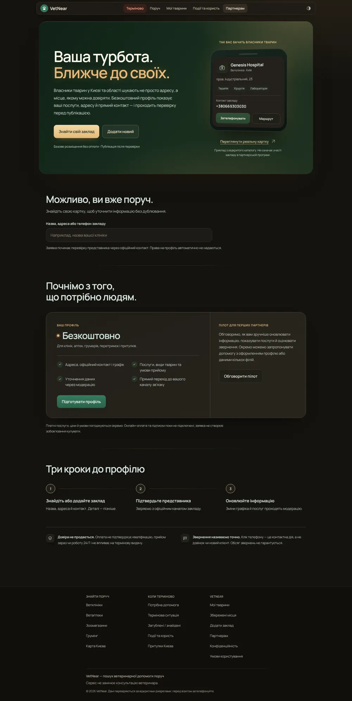

# QA 1.39

- `npm run verify` — 596 тестів ([лог](verify-v139.log)).
- Браузер — 62/62 двічі ([browser-checks.json](browser-checks.json)); перевірка переповнення тепер порівнює з шириною заданого вікна.
- Контраст (з урахуванням прозорості градієнтів) — 0 / 0.

| Іконки, світла | Іконки, темна |
| --- | --- |
|  |  |

| Іконки в контексті | Партнери, мобільна (нижня частина) |
| --- | --- |
|  |  |

| Партнери, десктоп, світла | Партнери, десктоп, темна |
| --- | --- |
|  |  |
