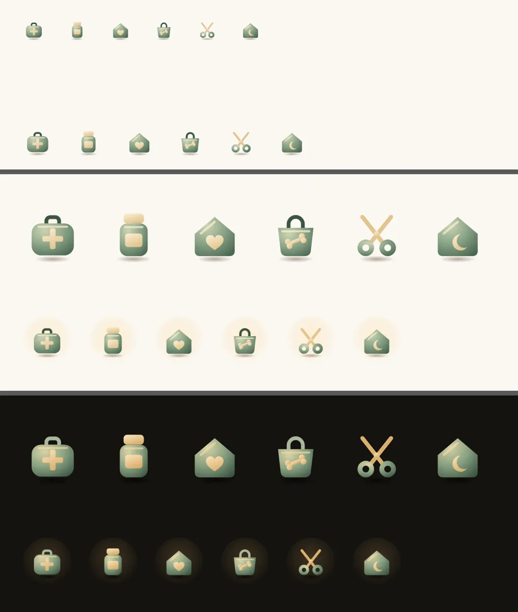
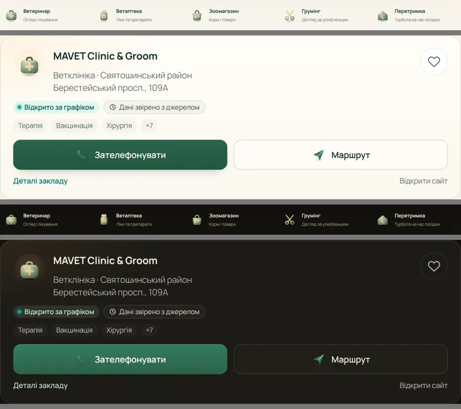
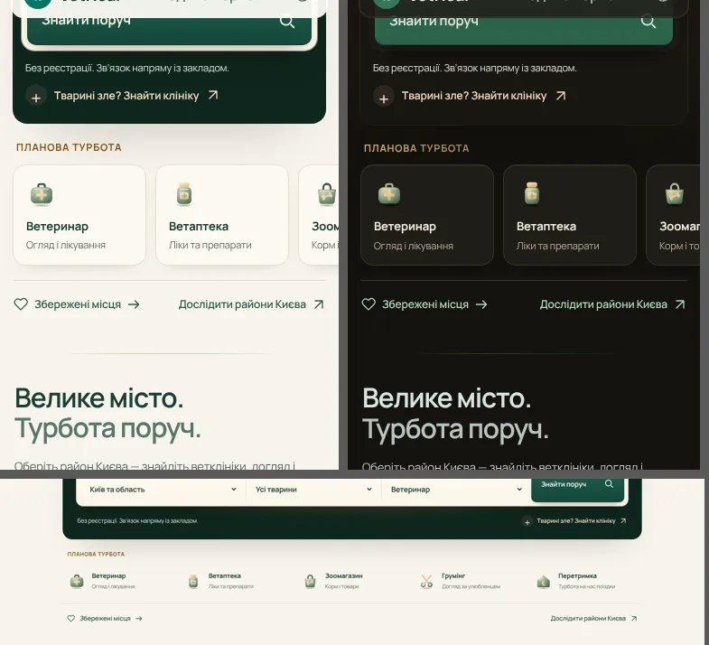
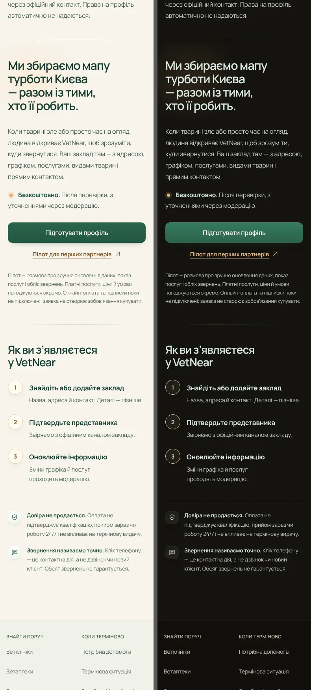
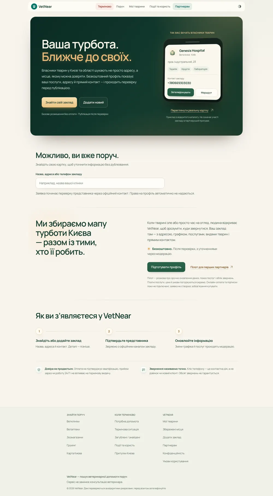
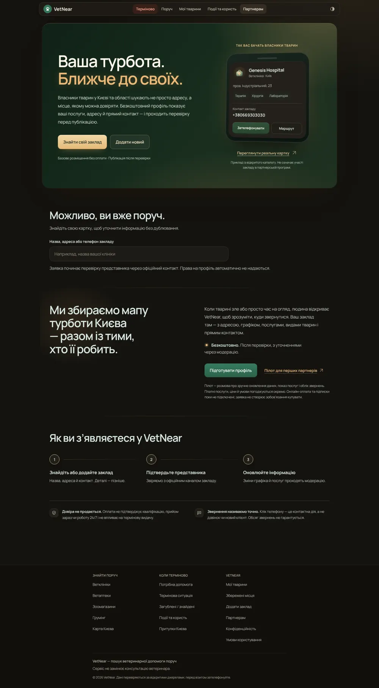

# QA 1.40

- `npm run verify` — 596 тестів ([лог](verify-v140.log)).
- Браузер — 62/62 двічі ([browser-checks.json](browser-checks.json)).
- Контраст — 0 / 0.
- Ширина на 390 px — 390.

| Предмети (24–64 px, у калюжі світла; світла й темна) | У контексті |
| --- | --- |
|  |  |

| Головна: терміново й планово | Партнери, мобільна |
| --- | --- |
|  |  |

| Партнери, десктоп, світла | Партнери, десктоп, темна |
| --- | --- |
|  |  |
