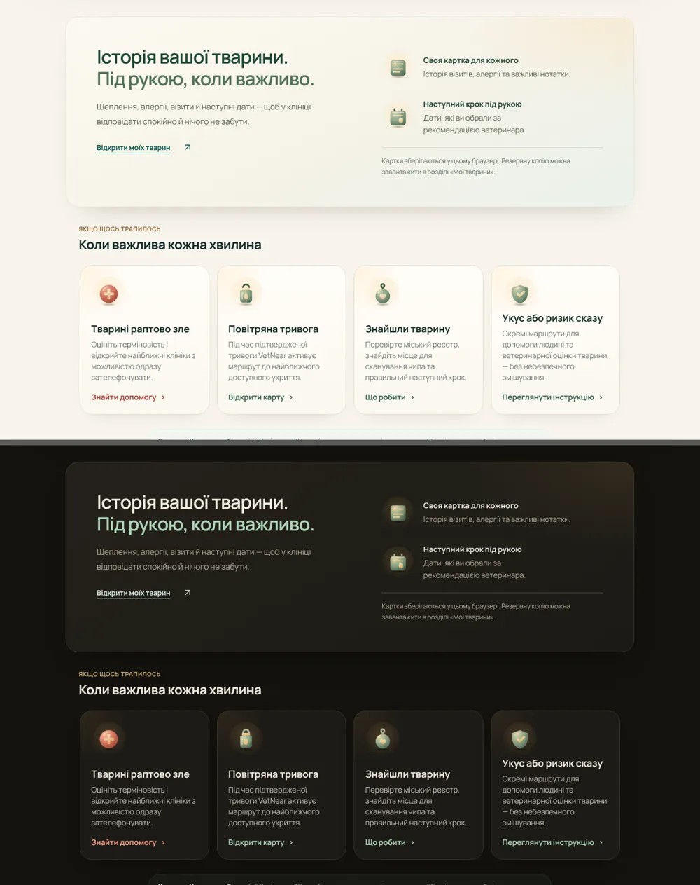
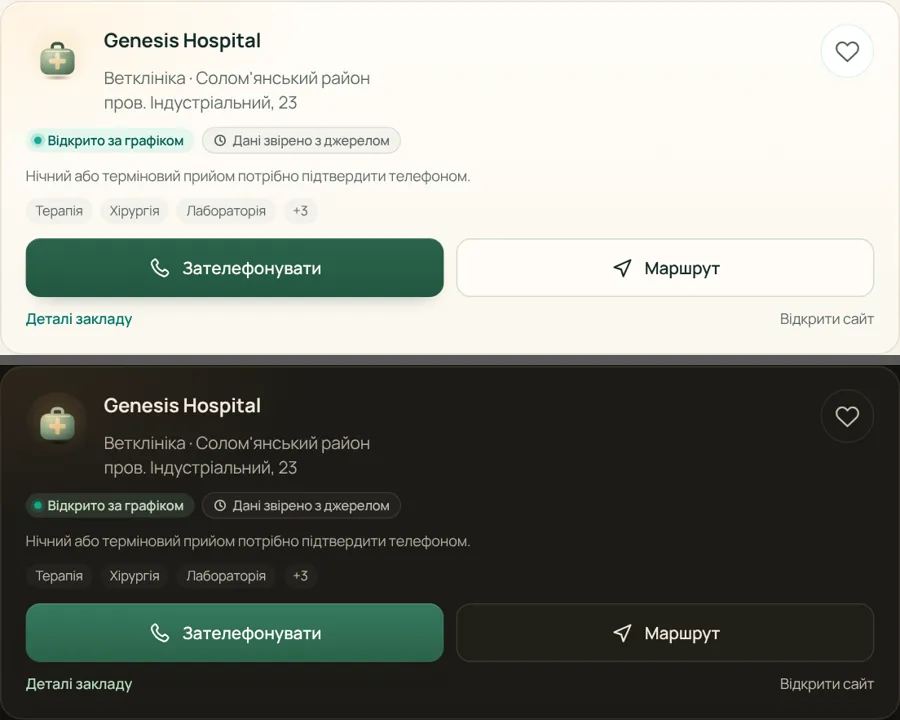
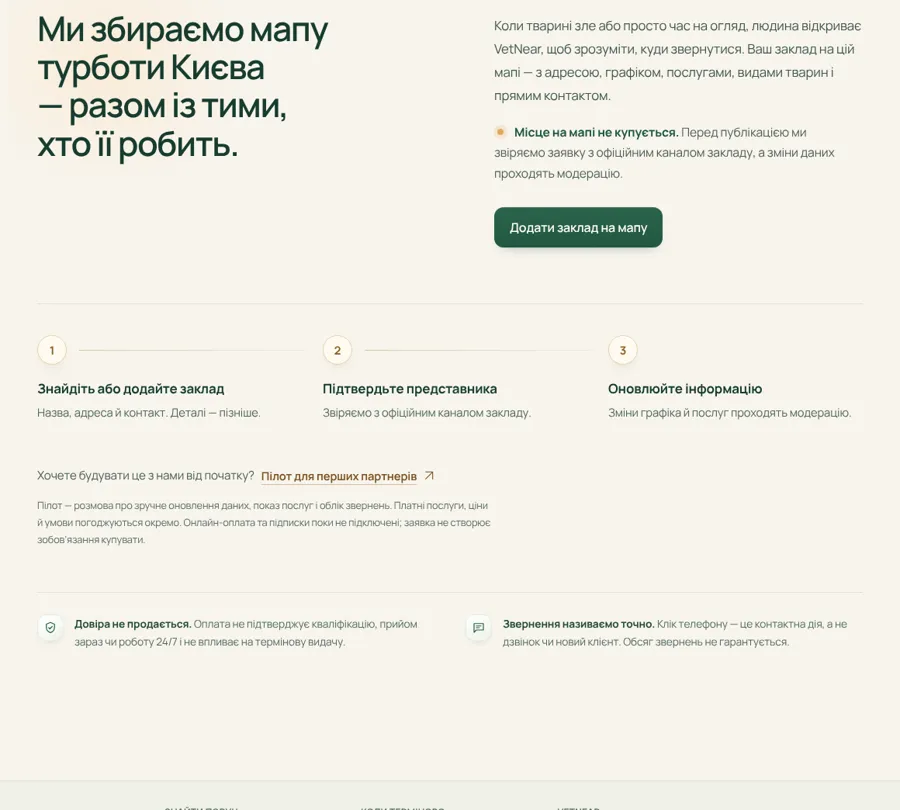
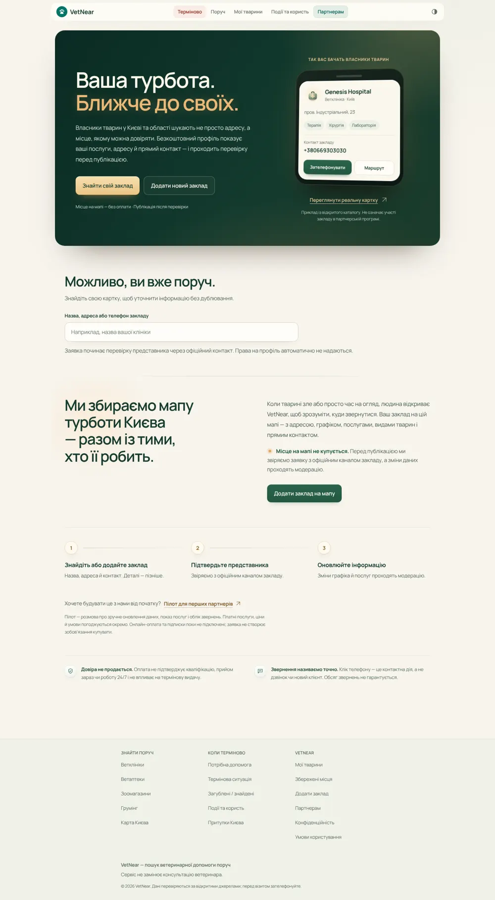
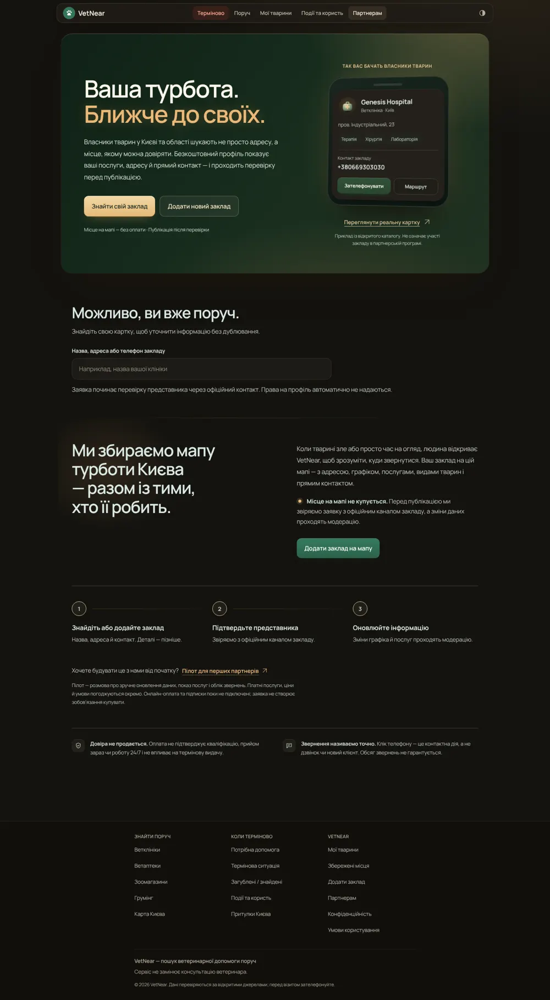

# QA 1.41

- `npm run verify` — 603 тести ([лог](verify-v141.log)).
- Браузер — 62/62 ([browser-checks.json](browser-checks.json)).
- Контраст — 0 / 0, зокрема ввечері, коли частина закладів «зачинена за графіком».

| Головна: власник і сценарії (світла / темна) | Картка закладу: предмет і тихі гліфи |
| --- | --- |
|  |  |

| Партнери: запрошення, кроки, бічні двері | |
| --- | --- |
|  | |

| Партнери, десктоп, світла | Партнери, десктоп, темна |
| --- | --- |
|  |  |
